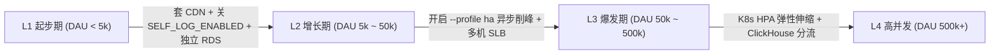
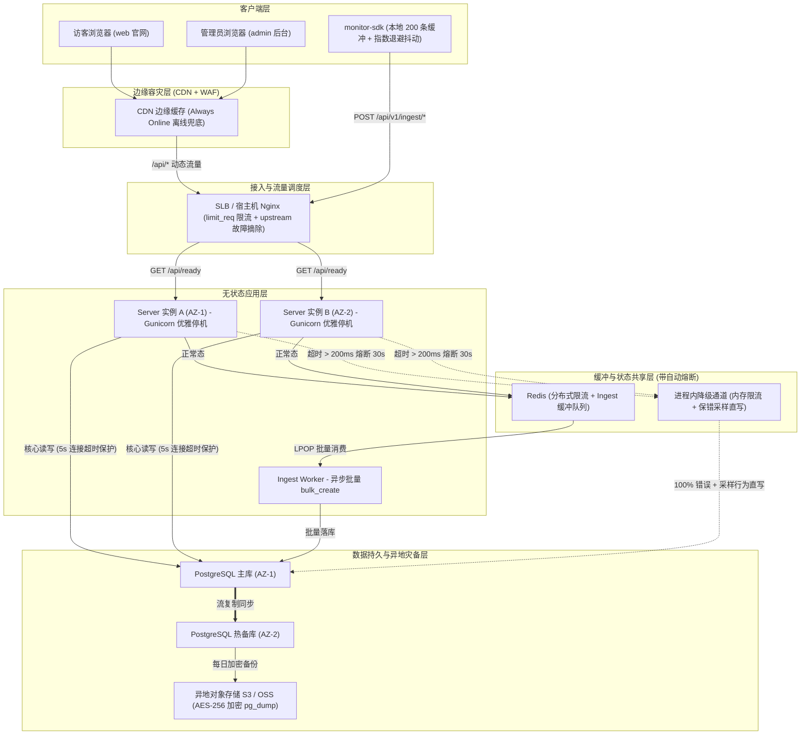
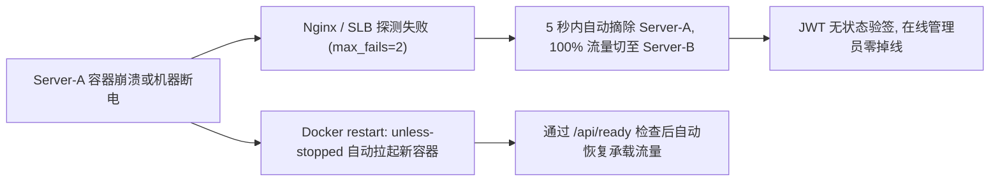
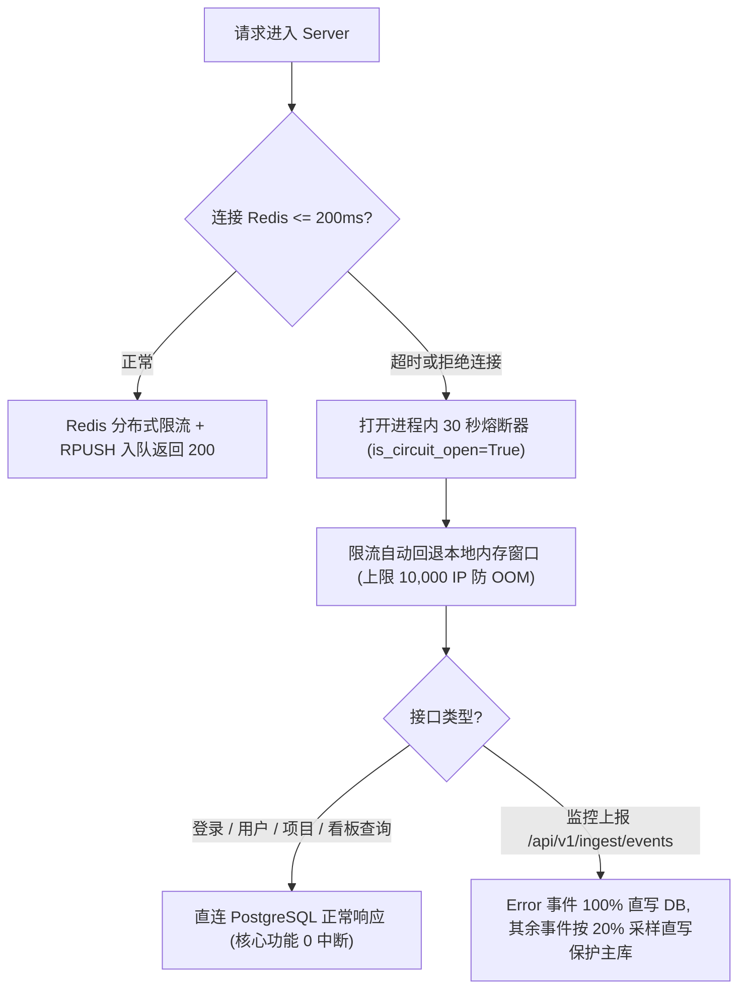
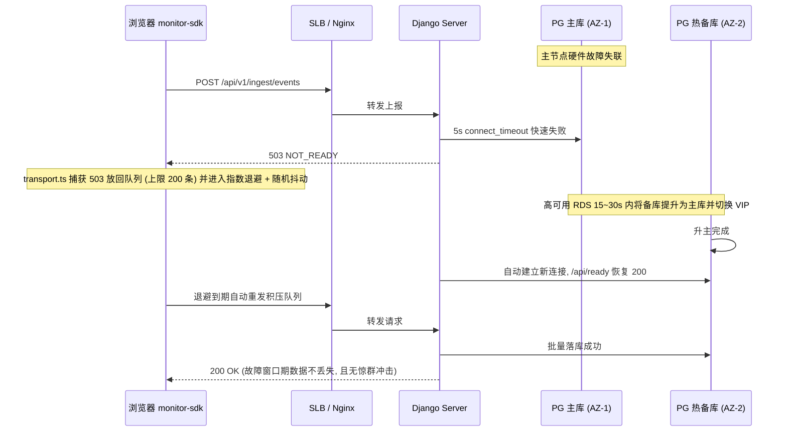
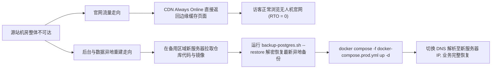

# AeroApex (`drone-website`) CI/CD、容量演进与容灾架构指南

本文档汇总本项目的 **自建 Git 自动化 CI/CD 方案**、**四阶段用户激增扩容路线（L1~L4）**、**容灾与高可用架构设计**、**四大故障场景具体走向流程** 以及 **生产运维操作手册（SOP）**。

---

## 目录

1. [仓库与生产部署文件索引](#1-仓库与生产部署文件索引)
2. [CI/CD 自动化发布方案（基于 Git 裸仓库 + Docker）](#2-cicd-自动化发布方案基于-git-裸仓库--docker)
3. [用户量激增：四阶段容量规划与集群分水岭](#3-用户量激增四阶段容量规划与集群分水岭)
4. [容灾与高可用架构设计](#4-容灾与高可用架构设计)
5. [四大故障场景：容灾具体走向流程图](#5-四大故障场景容灾具体走向流程图)
6. [已落地的代码级容灾与平滑扩容机制](#6-已落地的代码级容灾与平滑扩容机制)
7. [生产部署、一键升档与灾难恢复操作手册](#7-生产部署一键升档与灾难恢复操作手册)

---

## 1. 仓库与生产部署文件索引

| 文件路径 | 作用说明 |
| --- | --- |
| `docker-compose.prod.yml` | 生产容器编排：默认启动单机容灾基线（`postgres` + `server` + `web` + `admin`）；加 `--profile ha` 一键拉起 `redis` + `worker` 异步消费队列 |
| `deploy/web.Dockerfile` | 前台官网多阶段构建（Node 26 构建静态资源 -> Nginx 1.28 Alpine 托管） |
| `deploy/admin.Dockerfile` | 管理后台多阶段构建（以仓库根目录为上下文，包含 `../sdk` 源码别名依赖） |
| `deploy/spa-nginx.conf` | 前端容器内 Nginx 配置（SPA 路由回退、`gzip`、静态产物强缓存与 `/healthz` 探针） |
| `deploy/host-nginx.conf` | 宿主机 Nginx 1.28 反向代理、域名分流、`upstream` 故障摘流与网关层 `limit_req` 限流 |
| `deploy/post-receive.sh` | Git 裸仓库 `hooks/post-receive` 自动 CI/CD 脚本（`flock` 防并发 + 容器化 4 端检查 + 独立 `migrate` + 滚动发布 + `/api/ready` 验收） |
| `deploy/backup-postgres.sh` | PostgreSQL 定时导出、`AES-256` 加密、异地对象存储同步与 `--restore` 一键恢复脚本 |
| `deploy/.env.prod.example` | 生产环境变量模板（含单机基线与 HA 双通道切换注释） |
| `server/scripts/entrypoint.sh` | 后端容器多角色入口（支持 `web`、`migrate`、`worker` 三种运行模式与 Gunicorn 优雅停机） |
| `server/apps/monitor/services/resilience.py` | 零额外依赖的 Redis / 进程内存双通道限流器与上报队列 + 200ms 超时熔断器 |
| `server/apps/monitor/management/commands/run_ingest_worker.py` | 异步消费 Redis 队列并批量写入 PostgreSQL 的后台 Worker 命令 |
| `sdk/src/transport.ts` | 浏览器端监控 SDK 批量缓冲队列（最多 200 条）+ `5xx/429` 指数退避与随机抖动重试 |

---

## 2. CI/CD 自动化发布方案（基于 Git 裸仓库 + Docker）

针对 Ubuntu 服务器宿主机环境（无论宿主机自身 Node/Python 版本如何），将 `sdk`、`web`、`admin`、`server` 四端 CI 门禁全部放在标准版本的临时 Docker 容器中执行，宿主机仅承担 **Git 仓库托管 + Docker Compose 编排 + Nginx 反向代理**。

### 2.1 发布流水线流程图

```mermaid
flowchart LR
    Dev["开发机执行 git push prod main"] --> Hook["服务器 repo.git 触发 post-receive"]
    Hook --> Lock["flock 文件锁防止并发发布撞车"]
    Lock --> Checkout["检出最新代码至 /srv/drone-website/work"]
    Checkout --> CI["容器内执行 4 端 CI 门禁检查"]

    subgraph CIGate["CI 门禁 (任一失败立即中止)"]
        CISdk["sdk: npm ci && npm run check"]
        CIWeb["web: npm ci && npm run check"]
        CIAdmin["admin: npm ci && npm run check"]
        CIServer["server: uv sync --frozen && ./scripts/test.sh"]
    end

    CI --> CIGate
    CIGate -->|"任一报错"| Abort["非零退出并回传错误日志 (线上旧容器零影响)"]
    CIGate -->|"全部通过"| Build["注入短 SHA 构建生产镜像"]
    Build --> Migrate["独立执行一次性迁移: compose run --rm server migrate"]
    Migrate --> Rollout["滚动更新容器: compose up -d --remove-orphans"]
    Rollout --> Probe["轮询 GET /api/ready 校验 DB 与进程就绪"]
    Probe -->|"200 OK"| Done["发布完成"]
```



> 若后续迁移至 GitHub Actions / GitLab CI / Gitea Actions：`docker-compose.prod.yml`、`deploy/*.Dockerfile` 与 `deploy/host-nginx.conf` 完全复用，只需将 `deploy/post-receive.sh` 中的步骤拆分为 CI Runner 构建镜像推送到镜像仓库（GHCR / ACR），再通过 SSH 到目标服务器拉取镜像执行 `migrate` 与 `up -d`。

---

## 3. 用户量激增：四阶段容量规划与集群分水岭

**核心原则**：部署保持当前阶段所需的最小复杂度，代码提前留好「队列/直写」与「Redis/内存」切换插槽。**DAU 5 万（峰值 QPS 300）是决定是否需要上应用集群的分水岭。**

### 3.1 四阶段演进路线图



### 3.2 容量、硬件配置与集群需求对照表

| 阶段 | 用户与流量规模 | 推荐硬件与云资源配置 | 是否需要集群？ | 关键动作（无需重构业务代码） |
| --- | --- | --- | --- | --- |
| **L1 起步期** | DAU < 5,000<br>峰值 QPS < 30<br>并发在线 < 300 | `2核 4G` 云服务器 × 1<br>5M 带宽 + 50G SSD | **不需要集群**<br>单机 Docker Compose 即可 | 默认启动 `docker-compose.prod.yml`，配好每日自动加密备份与免费 CDN |
| **L2 增长期** | DAU 5,000 ~ 50,000<br>峰值 QPS 30 ~ 300<br>并发在线 300 ~ 3,000 | 应用机 `4核 8G` × 1<br>独立云托管 RDS `2核 4G`<br>全站静态资源接入 CDN | **不需要应用集群**<br>CDN 卸掉 90%+ 流量 + 数据库独立 | 1. 静态资源全走 CDN<br>2. `.env.prod` 设 `SELF_LOG_ENABLED=false`、`GUNICORN_WORKERS=4~8`<br>3. `DATABASE_URL` 指向托管高可用 RDS |
| **L3 爆发期** | DAU 50,000 ~ 500,000<br>峰值 QPS 300 ~ 3,000<br>并发在线 3,000 ~ 30,000 | SLB 负载均衡 + 应用机 `4核 8G` × 2~4 台<br>托管 Redis `4G`<br>高可用 RDS `8核 16G` + PgBouncer | **需要应用层集群**<br>+ 独立高可用 Redis / RDS | 1. 配置 `REDIS_URL` 与 `INGEST_MODE=redis_queue`，启动 `worker` 批量落库<br>2. SLB 后挂载多台无状态 `server` 节点<br>3. 监控明细表按月分区并定期归档 |
| **L4 高并发** | DAU 500,000+<br>峰值 QPS 3,000+<br>监控上报千万级/天 | K8s 节点池（`8核 16G` × N）<br>Redis Cluster / Kafka<br>PG 主从读写分离 + ClickHouse | **需要全链路高可用集群**<br>自动弹性扩缩容（HPA） | K8s 按 CPU/QPS 自动扩缩 Pod；海量监控明细由消费组写入 ClickHouse，与核心业务 PG 彻底物理隔离 |

---

## 4. 容灾与高可用架构设计

### 4.1 三层隔离设计原则

1. **前后端故障隔离**：前台展示站 `web/` 为纯静态 SPA，前置 CDN（开启离线兜底 `Always Online`）。即使源站后端与数据库全部宕机，全球访客仍可正常浏览无人机产品官网。
2. **核心业务与监控流量隔离**：登录鉴权、用户与项目管理走核心直连路径；高频监控上报（`/api/v1/ingest/*`）支持队列缓冲与故障采样降级；探针 `/api/ready` **仅检测主数据库连通性**，绝不因 Redis 抖动引发全站摘流雪崩。
3. **无状态计算与数据多副本隔离**：`server` 采用 JWT + 数据库存储 `RefreshToken` 哈希，进程自身无会话状态，任意节点宕机可秒级切流；数据层通过「热备流复制 + 异地加密定时备份」守住数据底线。

### 4.2 目标容灾架构全景图



---

## 5. 四大故障场景：容灾具体走向流程图

### 5.1 场景一：单台应用节点 / 容器崩溃（RTO < 5 秒，RPO = 0）



### 5.2 场景二：Redis 队列或缓存故障（RTO < 1 秒，自动熔断降级）



### 5.3 场景三：数据库主节点故障（RTO 15~30 秒，客户端缓冲闭环）



### 5.4 场景四：源站机房级断网 / 毁灭性灾难（官网 RTO = 0，后台异地恢复 < 30 分钟）



### 5.5 容灾等级 SLA（RTO / RPO）对照

| 部署档位 | 官网 `web` RTO | 后台与接口 `server` RTO | 数据恢复点目标 (RPO) |
| --- | --- | --- | --- |
| **档位 1：单机容灾基线**（CDN + 单机 Compose 自愈 + 每日异地加密备份） | **0 秒**（CDN 兜底） | 容器崩溃 **< 5 秒**；整机损毁异地重建 **< 30 分钟** | 整机硬盘损毁最多丢失最近一次备份后的数据（按定时周期 **1~24 小时**） |
| **档位 2：双活高可用集群**（CDN + SLB + 双机跨可用区 + Redis + 主备高可用 RDS） | **0 秒**（CDN 兜底） | 单机宕机 **< 5 秒**；主库切换 **15~30 秒** | **RPO ≈ 0**（主备实时流复制 + 云 RDS 按秒时间点回档 PITR） |

---

## 6. 已落地的代码级容灾与平滑扩容机制

1. **可插拔限流与异步队列 + 熔断降级（`server/apps/monitor/services/resilience.py`）**
   - 内置纯 Python 标准库 `socket` 的轻量级 RESP2 客户端，**无需额外安装第三方依赖包**即可对接生产 `Redis 6/7`。
   - 未配置 `REDIS_URL` 时，自动走进程内限流（带 `10,000` IP 容量上限防内存泄漏）与同步批量写库。
   - 配置 `REDIS_URL` 与 `INGEST_MODE=redis_queue` 后，监控上报写入 Redis 队列立即返回，由 `python manage.py run_ingest_worker` 批量消费落库；若消费期间遇数据库主备切换异常，未落库批次会自动 `LPUSH` 回塞队首，保证故障窗口期队列零丢数。
   - 本地限流窗口与熔断状态由线程锁保护，在 Gunicorn 多线程（`gthread`）并发下安全淘汰超限 IP。
   - 当 Redis 响应超过 `REDIS_TIMEOUT_MS`（默认 `200ms`）或断连时，自动开启 **30 秒熔断器**，无缝切回本地内存限流与保护性采样直写（`error` 事件 100% 保留，其余行为事件按 `INGEST_FALLBACK_SAMPLE_RATE=0.2` 采样）。
2. **数据库快速失败保护（`server/config/settings.py`）**
   - PostgreSQL 引擎下自动注入 `connect_timeout=5`（秒）和 `statement_timeout=10000`（毫秒），防止慢查询或数据库卡死拖垮全部 Gunicorn Worker。
3. **容器入口解耦与优雅停机（`server/scripts/entrypoint.sh` & `server/Dockerfile`）**
   - 支持 `web`、`migrate`、`worker` 三种启动角色；生产环境设置 `RUN_MIGRATIONS_ON_START=false` 并在发版阶段独立运行 `migrate`，彻底消除多副本并发迁移锁表竞态。
   - Gunicorn 支持环境变量动态调整 `GUNICORN_WORKERS`、`GUNICORN_THREADS`、`GUNICORN_TIMEOUT` 与 `GUNICORN_GRACEFUL_TIMEOUT`。
4. **前端 SDK 指数退避 + 随机抖动（`sdk/src/transport.ts`）**
   - `computeBackoffMs` 在遇到网络错误、`429` 或 `5xx` 时按 `base * 2^(failures - 1) + random(0..1000ms)` 退避（封顶 `60s`），服务恢复后自动清零计数并补发本地队列，防止故障恢复瞬间出现客户端重试风暴。

---

## 7. 生产部署、一键升档与灾难恢复操作手册

### 7.1 首次在当前 Ubuntu 服务器搭建 Git 自动发布

```bash
# 1. 创建部署目录与 Git 裸仓库
sudo mkdir -p /srv/drone-website/work /srv/drone-website/backups
sudo chown -R "$USER":"$USER" /srv/drone-website
git init --bare /srv/drone-website/repo.git

# 2. 准备生产环境变量（修改密码与密钥）
cp deploy/.env.prod.example /srv/drone-website/.env.prod
chmod 600 /srv/drone-website/.env.prod

# 3. 安装 Git 自动 CI/CD 钩子
cp deploy/post-receive.sh /srv/drone-website/repo.git/hooks/post-receive
chmod +x /srv/drone-website/repo.git/hooks/post-receive

# 4. 配置宿主机 Nginx 1.28 反向代理
sudo cp deploy/host-nginx.conf /etc/nginx/sites-available/drone-website.conf
sudo ln -sf /etc/nginx/sites-available/drone-website.conf /etc/nginx/sites-enabled/drone-website.conf
sudo nginx -t && sudo systemctl reload nginx

# 5. 在开发机添加远程并推送，即可触发全自动 CI 检查与上线
git remote add prod ssh://<user>@<server-ip>/srv/drone-website/repo.git
git push prod main
```

### 7.2 流量激增时：一键开启 Redis 异步队列削峰（无需改代码）

1. 编辑 `/srv/drone-website/.env.prod`，修改两项配置：
   ```dotenv
   REDIS_URL=redis://redis:6379/0
   INGEST_MODE=redis_queue
   SELF_LOG_ENABLED=false
   GUNICORN_WORKERS=8
   ```
2. 以 `ha` Profile 启动 `redis` 与 `worker` 并平滑重载 `server`：
   ```bash
   cd /srv/drone-website/work
   PROD_ENV_FILE=/srv/drone-website/.env.prod \
     docker compose --profile ha -f docker-compose.prod.yml up -d
   ```
   （后续在 `post-receive` 中设置 `ENABLE_HA_PROFILE=true` 即可每次推送自动维护 `ha` 编排。）

### 7.3 配置每日自动加密备份与灾难恢复演练

```bash
# 1. 赋予备份脚本执行权限
chmod +x /srv/drone-website/work/deploy/backup-postgres.sh

# 2. 加入每日凌晨 03:00 定时备份（可选配置 RCLONE_REMOTE_DEST 同步到异地 S3/OSS）
# crontab -e 添加：
# 0 3 * * * BACKUP_PASSPHRASE='你的高强度加密口令' RCLONE_REMOTE_DEST='oss:drone-backups' /srv/drone-website/work/deploy/backup-postgres.sh >> /srv/drone-website/backup.log 2>&1

# 3. 灾难恢复 / 异地新机器一键还原数据：
BACKUP_PASSPHRASE='你的高强度加密口令' \
  ./deploy/backup-postgres.sh --restore /srv/drone-website/backups/pg_drone_website_server_xxx.sql.gz.enc
```
