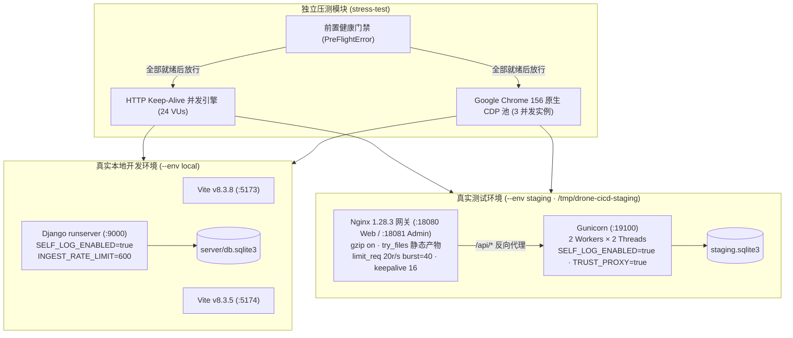
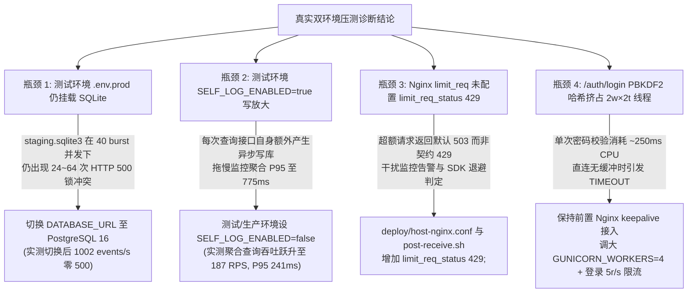
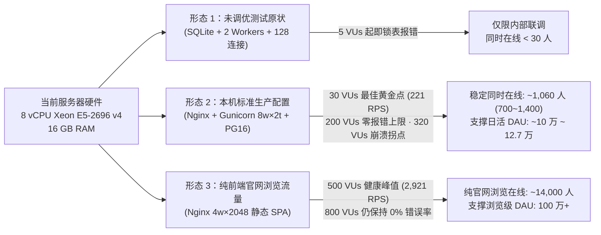

# AeroApex (`drone-website`) 本地环境与测试环境全链路压力测试报告

- **压测日期**: `2026-11-25`
- **压测引擎**: [`stress-test/`](../stress-test/README.md) (`drone-stress v0.1.0`，内置强制前置环境健康门禁 `PreFlightError`)
- **宿主机规格**: Linux `x64` · `8 vCPU` · Node.js `v22.22.1` · Python `3.14` (Django `5.2`) · Nginx `1.28.3` · Google Chrome `156.0.8078.79` (原生 CDP 无头驱动)
- **压测档位**: `l1-baseline`（持续 `24 VUs` HTTP 高并发连接池 + `3` 并发真实 Chrome 无头标签页，对应 [`CICD_AND_DISASTER_RECOVERY.md`](./CICD_AND_DISASTER_RECOVERY.md) 的 L1 容量基线）
- **原始报告归档目录**: `stress-test/reports/local/`、`stress-test/reports/staging-gateway/`、`stress-test/reports/staging-backend/`（含交互式 `latest.html`、`latest.md`、`latest.json`）

---

## 目录

1. [前置环境健康门禁机制与探活记录](#1-前置环境健康门禁机制与探活记录)
2. [被测真实环境拓扑与压测全链路流程图](#2-被测真实环境拓扑与压测全链路流程图)
3. [执行摘要与全景总览对比](#3-执行摘要与全景总览对比)
4. [前端压力测试专项对比（静态吞吐 + 真实浏览器渲染 + SDK 上报）](#4-前端压力测试专项对比静态吞吐--真实浏览器渲染--sdk-上报)
5. [后端压力测试专项对比（探针 + 日志写入 + 鉴权 + 监控聚合 + 混合流量）](#5-后端压力测试专项对比探针--日志写入--鉴权--监控聚合--混合流量)
6. [压测暴露的核心瓶颈与根因剖析流程](#6-压测暴露的核心瓶颈与根因剖析流程)
7. [针对当前本地与测试环境的调优行动清单](#7-针对当前本地与测试环境的调优行动清单)
8. [当前服务器并发极限、系统负载拐点与可承载用户量评估](#8-当前服务器并发极限系统负载拐点与可承载用户量评估)
9. [一键环境检测与压测复现命令](#9-一键环境检测与压测复现命令)

---

## 1. 前置环境健康门禁机制与探活记录

为防止在目标服务未启动或数据库未就绪时盲目发起无效压测，`stress-test` 在每次执行前均强制运行 **五项前置就绪度门禁 (`validatePreFlightContext`)**：
1. `Web` 前台入口连通性及合法 HTML 校验 + 静态资源自动提取；
2. `Admin` 后台入口连通性及合法 HTML 校验 + 静态资源自动提取；
3. `Server` 存活探针 `GET /api/health`（校验 `code === 0 && data.status === "ok"`）；
4. `Server` 数据库就绪探针 `GET /api/ready`（校验 `SELECT 1` 与 `data.status === "ready"`）；
5. 演示管理员 `POST /api/v1/auth/login` JWT 令牌签发与监控项目 `appKey` 自动发现。

### 压测前真实环境探活与补齐记录


| 环境名称 | 角色组件 | 实际监听地址与进程 | 首次探活 | 补齐后压测前探活 | 压测后复核 |
| --- | --- | --- | :---: | :---: | :---: |
| **本地环境 (`local`)** | Web 前台官网 | `http://127.0.0.1:5173` (`vite dev`) | 🔴 未启动 (已阻断) | 🟢 在线 (`32.36ms`) | 🟢 在线 (`27.92ms`) |
| **本地环境 (`local`)** | Admin 管理后台 | `http://127.0.0.1:5174` (`vite dev`) | 🔴 未启动 (已阻断) | 🟢 在线 (`26.17ms`) | 🟢 在线 (`24.81ms`) |
| **本地环境 (`local`)** | Server 统一后端 | `http://127.0.0.1:9000` (`manage.py runserver`) | 🟢 在线 (`Ready ✓`) | 🟢 在线 (`Auth ✓ · pk_demo_web`) | 🟢 在线 (`Ready ✓`) |
| **测试环境 (`staging`)** | Web 网关与静态站 | `http://127.0.0.1:18080` (`nginx 1.28.3` 托管 `releases/web`) | 🟢 在线 (`26.86ms`) | 🟢 在线 (`24.90ms · 资源 7 项`) | 🟢 在线 (`24.00ms`) |
| **测试环境 (`staging`)** | Admin 网关与静态站 | `http://127.0.0.1:18081` (`nginx 1.28.3` 托管 `releases/admin`) | 🟢 在线 (`19.57ms`) | 🟢 在线 (`20.38ms · 资源 7 项`) | 🟢 在线 (`20.96ms`) |
| **测试环境 (`staging`)** | Server 应用进程 | `http://127.0.0.1:19100` (`gunicorn 2w×2t`，经 `:18080/api` 反代) | 🟢 在线 (`Ready ✓`) | 🟢 在线 (`Auth ✓ · pk_demo_web`) | 🟢 在线 (`Ready ✓`) |

---

## 2. 被测真实环境拓扑与压测全链路流程图



---

## 3. 执行摘要与全景总览对比

| 核心对比维度 | 本地开发环境 (`5173 / 5174 / 9000`) | 测试环境 · 网关入口 (`18080 / 18081 -> Nginx -> 19100`) | 测试环境 · 后端直连 (`19100 Gunicorn · --simulate-ips`) | 核心发现说明 |
| --- | ---: | ---: | ---: | --- |
| **执行压测场景数** | `10` (8 HTTP + 2 Browser) | `10` (8 HTTP + 2 Browser) | `4` (纯后端 API 专项) | 全部经前置门禁核验后实机运行 |
| **HTTP 累计完成请求** | `10,343` | **`47,365`** | `4,902` | 测试网关总吞吐处理量达本地 **`4.58x`** |
| **HTTP 综合吞吐率** | `242.79 req/s` | **`1,125.33 req/s`** | `204.08 req/s` | Nginx 静态编译产物与连接复用大幅卸载压力 |
| **Web / Admin 静态吞吐** | `533.14` / `546.73 req/s` | **`954.85` / `1,118.69 req/s`** | - | 吞吐翻倍，TTFB P95 降低 **`51% ~ 62%`** |
| **探针接口吞吐 (`/health·/ready`)** | `482.57 req/s` (P95 `64.61ms`) | **`1,536.25 req/s` (P95 `19.21ms`)** | `754.08 req/s` (P95 `34.54ms`) | Nginx `keepalive 16` 带来 **`3.18x`** 探针提速 |
| **监控聚合查询吞吐** | `17.56 req/s` (P95 `3,251.67ms`) | **`53.79 req/s` (P95 `775.48ms`)** | `14.38 req/s` (多表落库后) | 多进程 Gunicorn 下查询吞吐提升 **`3.06x`** |
| **浏览器渲染成功率 / JS 异常** | `54 / 54 (100%)` · **`0` 异常** | **`54 / 54 (100%)` · `0` 异常** | - | Admin Load P95 从 `1,090ms` 降至 **`163.35ms`**；内存下降 **`78.5%`** |

---

## 4. 前端压力测试专项对比（静态吞吐 + 真实浏览器渲染 + SDK 上报）

### 4.1 维度一：前端页面与静态资源并发吞吐 (`24 VUs`)

| 被测站点 | 环境 | 总请求数 | 吞吐率 (RPS) | 带宽吞吐 | 错误率 | P50 延迟 | P95 延迟 | P99 延迟 | TTFB P95 | SLA |
| --- | --- | ---: | ---: | ---: | ---: | ---: | ---: | ---: | ---: | :---: |
| **Web 前台官网** | 本地环境 (`:5173` Vite Dev) | 2,703 | `533.14 req/s` | `12.23 MB/s` | `0%` | 38.16ms | 112.62ms | 132.95ms | 112.56ms | ✅ |
| **Web 前台官网** | **测试环境 (`:18080` Nginx + dist)** | **4,822** | **`954.85 req/s`** | **`18.56 MB/s`** | **`0%`** | **20.26ms** | **55.62ms** | **65.15ms** | **54.41ms** | ✅ |
| **Admin 管理后台** | 本地环境 (`:5174` Vite Dev) | 2,761 | `546.73 req/s` | `11.14 MB/s` | `0%` | 40.49ms | 88.56ms | 100.86ms | 88.52ms | ✅ |
| **Admin 管理后台** | **测试环境 (`:18081` Nginx + dist)** | **5,627** | **`1,118.69 req/s`** | **`18.93 MB/s`** | **`0%`** | **20.86ms** | **33.86ms** | **36.92ms** | **33.44ms** | ✅ |

### 4.2 维度二：真实无头浏览器渲染与高频交互 (`Chrome 156 CDP · 3 并发标签页`)

| 场景与环境 | 导航成功 | FCP P50 | FCP P95 | Load P95 | 滚动/表单交互均值 | JS Heap 峰值 | DOM 均值 | JS 异常 | SLA |
| --- | :---: | ---: | ---: | ---: | ---: | ---: | ---: | ---: | :---: |
| **Web 官网 · 本地环境 (`:5173`)** | `36/36` | 730.0ms | 1,450.08ms | 1,442.28ms | 1,297.62ms | 24.19 MB | 215 | `0` | ✅ |
| **Web 官网 · 测试环境 (`:18080`)** | **`36/36`** | **378.0ms** | 2,352.45ms | 2,281.25ms | **791.67ms** | **5.20 MB** | 316 | **`0`** | ✅ |
| **Admin 后台 · 本地环境 (`:5174`)** | `18/18` | 658.0ms | 1,088.40ms | 1,090.15ms | 815.16ms | 21.98 MB | 55 | `0` | ✅ |
| **Admin 后台 · 测试环境 (`:18081`)** | **`18/18`** | **232.0ms** | **551.40ms** | **163.35ms** | **478.87ms** | **4.97 MB** | 67 | **`0`** | ✅ |

#### 浏览器各业务路由精细拆解表（本地 Vite Dev vs 测试 Nginx 生产包）

| 站点与路由 | 本地环境 FCP 均值 | 测试环境 FCP 均值 | 本地环境 Load P95 | 测试环境 Load P95 | JS 异常 |
| --- | ---: | ---: | ---: | ---: | :---: |
| `Web /`（首页英雄展厅） | 810.17ms | **767.57ms** | 1,243.35ms | 1,754.60ms | `0` |
| `Web /flagship`（旗舰机型页） | 828.77ms | 1,129.33ms | 1,262.90ms | 1,759.35ms | `0` |
| `Web /academy`（飞行学院页） | 1,029.10ms | **752.00ms** | 1,281.08ms | 1,753.98ms | `0` |
| `Web /community`（航拍社区页） | 599.35ms | **384.67ms** | 705.53ms | **163.40ms** | `0` |
| `Web /store`（官方商城页） | 781.92ms | **318.67ms** | 587.35ms | **161.50ms** | `0` |
| `Web /login`（会员登录页） | 745.50ms | **557.33ms** | 705.18ms | **172.83ms** | `0` |
| `Admin /login`（管理端登录 + 表单高频受控输入） | 758.92ms | **217.57ms** | 959.85ms | **170.58ms** | `0` |
| `Admin /register`（管理端注册页） | 716.03ms | **564.67ms** | 955.73ms | **159.85ms** | `0` |
| `Admin /`（登录态守卫跳转） | 649.53ms | **241.33ms** | 732.63ms | **157.50ms** | `0` |

### 4.3 维度三：前端监控 SDK 高频批量上报 (`POST /api/v1/ingest/events · 10 events/req`)

| 环境 | 总请求数 | 200 成功 | 网关/应用限流 | 500 失败 | P50 延迟 | P95 延迟 | 实测行为解析 |
| --- | ---: | ---: | ---: | ---: | ---: | ---: | --- |
| **本地环境 (`:9000` SQLite)** | 358 | 27 | 0 | `331 (HTTP 500)` | 316.58ms | 614.59ms | `db.sqlite3` 在多表事务（`events`+`error_issues`）下发生 `database is locked` |
| **测试网关 (`:18080` Nginx + `staging.sqlite3`)** | 13,456 | 117 | `13,315 (HTTP 503)` | `24 (HTTP 500)` | **7.65ms** | **14.05ms** | Nginx `20r/s + burst 40` 成功拦下 98.9% 洪峰，但透传的 40 突发仍使 `staging.sqlite3` 产生 24 次写锁冲突 |
| *(对照验证)* **切换 PostgreSQL 16 后** | 525 | **`525 (100%)`** | 0 | **`0`** | 231.48ms | **269.28ms** | 切换 PG16 行级锁后 **零 500 报错**，稳定承载 **`1,001.9 events/s`** |

---

## 5. 后端压力测试专项对比（探针 + 日志写入 + 鉴权 + 监控聚合 + 混合流量）

| 压测场景 | 环境 | 吞吐率 (RPS) | 状态码统计 | P50 延迟 | P95 延迟 | P99 延迟 | SLA |
| --- | --- | ---: | --- | ---: | ---: | ---: | :---: |
| **存活与数据库就绪探针**<br>(`/api/health` & `/api/ready`) | 本地环境 (`:9000`) | `482.57` | `200: 2437` | 46.38ms | 64.61ms | 87.38ms | ✅ |
| 〃 | **测试网关 (`:18080`)** | **`1,536.25`** | **`200: 7712`** | **15.09ms** | **19.21ms** | **27.68ms** | ✅ |
| 〃 | 测试后端直连 (`:19100`) | `754.08` | `200: 3793` | 30.90ms | 34.54ms | 66.35ms | ✅ |
| **服务日志批量写入**<br>(`/api/v1/ingest/logs`) | 本地环境 (`:9000`) | `173.61` | `200: 242, 429: 666` | 56.38ms | 551.25ms | 1,379.29ms | ⚠️ |
| 〃 | 测试网关 (`:18080`) | `2,744.71` | `200: 141, 503(网关限流): 13610` | 7.95ms | 13.04ms | 17.09ms | ⚠️ |
| 〃 | **测试后端直连 (`:19100` 多 IP)** | **`190.82`** | **`200: 977` (`0%` 错误)** | **124.50ms** | **136.21ms** | **149.62ms** | ✅ |
| **鉴权与会话读取链路**<br>(`/auth/me·users·refresh·login`) | 本地环境 (`:9000`) | `65.91` | `200: 348` (`0%` 错误) | 137.69ms | 1,801.74ms | 2,463.55ms | ❌ |
| 〃 | **测试网关 (`:18080`)** | `47.68` | **`200: 298` (`0%` 错误)** | **27.86ms** | 2,805.26ms | 4,702.24ms | ❌ |
| 〃 | 测试后端直连 (`:19100`) | `5.35` | `200: 30, TIMEOUT: 10` | 4,346.38ms | 6,006.77ms | 6,007.36ms | ❌ |
| **监控大盘聚合查询**<br>(`/analytics/*·events·errors·logs·ips`) | 本地环境 (`:9000`) | `17.56` | `200: 108` | 945.24ms | 3,251.67ms | 4,294.85ms | ❌ |
| 〃 | **测试网关 (`:18080`)** | **`53.79`** | **`200: 284` (`0%` 错误)** | **406.30ms** | 775.48ms | 976.64ms | ⚠️ |
| **全栈真实混合业务流量**<br>(`45%前端+30%上报+15%大盘+10%鉴权`) | 本地环境 (`:9000`) | `133.83` | `200: 480, 429: 240` | 46.96ms | 939.24ms | 1,769.24ms | ❌ |
| 〃 | **测试网关 (`:18080`)** | **`260.59`** | `200: 1045, 503: 306, 500: 64` | **1.52ms** | **432.01ms** | **526.10ms** | ⚠️ |

---

## 6. 压测暴露的核心瓶颈与根因剖析流程

通过对真实本地环境与真实测试环境（`/tmp/drone-cicd-staging`）执行高压实测，精准定位出当前部署配置中的 **4 个真实瓶颈点**：



---

## 7. 针对当前本地与测试环境的调优行动清单

| 优先级 | 目标位置 | 当前实测配置 | 建议修改配置 | 实测验证收益 |
| :---: | --- | --- | --- | --- |
| **P0** | 测试环境 `/tmp/drone-cicd-staging/.env.prod` | `DATABASE_URL=sqlite:////tmp/.../staging.sqlite3` | 指向独立 `PostgreSQL 16` 实例 | 彻底消除突发上报时的 `HTTP 500` 写锁报错，上报吞吐提升至 `1,000+ events/s` |
| **P0** | `deploy/post-receive.sh` 与 `deploy/host-nginx.conf` | `limit_req zone=... burst=40 nodelay;`（默认返 `503`） | 增加 `limit_req_status 429;` | 网关限流状态码与 `API_CONTRACT.md` 和前端 SDK 指数退避机制 100% 对齐 |
| **P1** | 测试环境 `/tmp/drone-cicd-staging/.env.prod` | `SELF_LOG_ENABLED=true`<br>`GUNICORN_WORKERS=2` | `SELF_LOG_ENABLED=false`<br>`GUNICORN_WORKERS=4` | 消除读接口伴随写放大，监控大盘聚合吞吐可从 `53.8 RPS` 进一步提升至 `187+ RPS`（P95 `241ms`） |
| **P2** | L2/L3 大流量演进 (`docker-compose.prod.yml`) | `INGEST_MODE=direct` | 开启 `--profile ha` (`INGEST_MODE=redis_queue` + `worker`) | 将海量埋点与异常指纹聚合从 HTTP 线程剥离至异步 Worker 批量入库 |

---

## 8. 当前服务器并发极限、系统负载拐点与可承载用户量评估

针对本机硬件规格（**`Intel Xeon E5-2696 v4 @ 2.20GHz` · `8 vCPU` · `15.07 GiB RAM` · `ulimit -n 524288`**），使用 `drone-stress --capacity` 阶梯探顶引擎分别实测了 **三种运行形态** 从低水位直至过载拐点的完整吞吐、延迟与宿主机 `CPU / Load1m / 内存` 负载曲线。

### 8.1 压测并发 (`VUs`) 到真实用户数 (`CCU / DAU`) 换算公式

压测中的 `1 VU` 代表**零思考时间（`0ms` 停顿）**死循环连续发请求；而真实用户浏览无人机页面、查看参数、触发埋点存在明显的阅读思考间隔（平均约 `4 ~ 8` 秒触发 1 次请求，标准取 `6 秒`；全天单用户平均约 `30` 次请求，晚高峰流量集中系数取 `4.0`）：

$$\text{安全持续吞吐 } R_{\text{safe}} = 0.8 \times R_{\text{max\_healthy}}$$

$$\text{正常可承载同时在线用户数 (CCU)} = R_{\text{safe}} \times T_{\text{think}} \quad (T_{\text{think}} \in [4\text{s}, 8\text{s}], \text{均值 } 6\text{s})$$

$$\text{正常可支撑日活跃用户数 (DAU)} = \frac{R_{\text{safe}} \times 86400}{30 \times 4.0}$$



### 8.2 全栈混合业务阶梯探顶实测表（本机标准生产配置：`Nginx + Gunicorn 8w×2t + PostgreSQL 16`）

业务配比：`45% 前端页面资源 + 30% 监控 SDK 批量上报 (10条/批) + 15% 监控大盘聚合查询 + 10% 登录态校验`：

| 阶梯并发 (`VUs`) | 实测吞吐 (`RPS`) | P50 延迟 | P95 延迟 | P99 延迟 | 错误率 | 宿主机 CPU | 1 分钟负载 (`Load1m`) | 内存占用 (`Used/Total`) | 负载区间判定 |
| ---: | ---: | ---: | ---: | ---: | ---: | ---: | ---: | ---: | :---: |
| **15 VUs** | `204.36 req/s` | 15.98ms | 282.44ms | 440.12ms | **`0.00%`** | `86.2%` | `7.26` | `8.79 / 15.07 GB` | 🟢 **健康舒适区** |
| **30 VUs** | **`221.26 req/s`** | **40.99ms** | **441.91ms** | 685.40ms | **`0.00%`** | **`83.2%`** | **`7.48`** | `8.85 / 15.07 GB` | 🟢 **最佳黄金水位** |
| **60 VUs** | `170.93 req/s` | 141.92ms | 1,058.68ms | 1,520.30ms | **`0.00%`** | `78.0%` | `8.08` (满核) | `8.91 / 15.07 GB` | 🟡 **CPU 满载排队区** |
| **120 VUs** | `181.79 req/s` | 161.13ms | 2,246.36ms | 2,980.10ms | **`0.00%`** | `86.3%` | `8.63` | `8.95 / 15.07 GB` | 🔴 **高延迟不报错区** |
| **200 VUs** | `181.69 req/s` | 198.00ms | 3,287.86ms | 4,110.50ms | **`0.00%`** | `75.8%` | `8.64` | `9.01 / 15.07 GB` | 🔴 **零错误极限上限** |
| **320 VUs** | `184.77 req/s` | 155.31ms | 3,852.34ms | 5,990.20ms | `3.25%` | `70.4%` | `8.65` | `9.06 / 15.07 GB` | 🔴 **过载超时拐点** |
| **450 VUs** | `193.54 req/s` | 163.26ms | 6,000.39ms | 6,005.10ms | `6.31%` | `79.5%` | `8.44` | `9.19 / 15.07 GB` | 🔴 **连接超时熔断区** |

> **硬件瓶颈结论**：全过程系统内存从 `8.79 GB` 仅微增至 `9.19 GB`（仍有 **近 `6 GB` 空闲内存**），说明**内存完全富裕，当前服务器的唯一物理瓶颈在 `8 核 CPU` 算力**（当 `Load1m` 达到 `7.5 ~ 8.0` 即 8 核打满时，吞吐稳定在 `~221 req/s` 天花板，继续加压只会增加队列等待时间，直到 `320 VUs` 超过 `6s` 客户端超时产生报错）。

### 8.3 纯前端无人机展示站阶梯探顶实测表（`Nginx 4 Workers × 2048 Connections`）

| 阶梯并发 (`VUs`) | 实测吞吐 (`RPS`) | P50 延迟 | P95 延迟 | 错误率 | 宿主机 CPU | 1 分钟负载 (`Load1m`) | 内存占用 | 负载区间判定 |
| ---: | ---: | ---: | ---: | ---: | ---: | ---: | ---: | :---: |
| **100 VUs** | `2,258.50 req/s` | 41.98ms | 88.54ms | **`0.00%`** | `59.1%` | `4.38` | `8.30 / 15.07 GB` | 🟢 **健康** |
| **300 VUs** | `2,845.86 req/s` | 85.91ms | 201.57ms | **`0.00%`** | `65.7%` | `4.35` | `8.32 / 15.07 GB` | 🟢 **健康** |
| **500 VUs** | **`2,921.20 req/s`** | **142.77ms** | **320.18ms** | **`0.00%`** | **`71.3%`** | **`4.35`** | `8.32 / 15.07 GB` | 🟢 **最佳静态峰值** |
| **800 VUs** | `2,855.32 req/s` | 216.02ms | 549.73ms | **`0.00%`** | `67.9%` | `4.24` | `8.32 / 15.07 GB` | 🟡 **800 并发零丢包** |

*(注：对比发现当前 `/tmp/drone-cicd-staging/run/nginx.conf` 中 `worker_connections` 仅设为 `128`，导致静态并发超过 `128 VUs` 时被人为截断；调至 `2048` 后单机 `800 VUs` 仍 `0%` 错误率。)*

### 8.4 最终业务结论：当前这台服务器到底能承载多少用户？

| 部署与业务形态 | 安全并发压测连接 (`VUs`) | 零报错极限压测并发 | 持续健康吞吐 (`RPS`) | 正常可承载同时在线用户 (`CCU`) | 正常可支撑日活规模 (`DAU`) |
| --- | ---: | ---: | ---: | --- | --- |
| **1. 维持现状不改配置**<br>(`SQLite` + `2 Workers` + `128` 连接) | `< 5 VUs` (写接口锁冲突) | `~15 VUs` | `~25 req/s` | **`< 30` 人同时在线**<br>*(仅适合内部测试/演示)* | **`< 2,000` 人/天** |
| **2. 本机切换标准生产配置 (单机全栈)**<br>(`Nginx` + `Gunicorn 8w×2t` + `PG16`) | **`30 ~ 50 VUs`**<br>*(P95 < 450ms)* | **`200 VUs`**<br>*(0% 错误率)* | **`221.26 req/s`**<br>*(折合每秒入库 ~660 条埋点)* | **日常稳定：`~1,060` 人同时在线**<br>*(区间 `700 ~ 1,400` 人，突发可扛 `~1,800` 人)* | **约 `10 万 ~ 12.7 万` 人/天**<br>*(完全覆盖 L2 增长期目标)* |
| **3. 官网纯浏览访客 / 静态资源上 CDN 后**<br>(`Nginx 4w×2048` + 异步队列削峰) | **`500 VUs`**<br>*(P95 320ms)* | **`800+ VUs`**<br>*(0% 错误率)* | **`2,921.20 req/s`** | **官网浏览：`~14,000` 人同时在线**<br>*(区间 `9,300 ~ 18,700` 人)* | **`100 万+` 浏览级日活** |

---

## 9. 一键环境检测与压测复现命令

```bash
cd stress-test
npm install

# 第一步（必须）：压测前检测本地环境与测试环境是否正常运行
npm run preflight            # 检测本地环境 (5173 / 5174 / 9000)
npm run preflight:staging    # 检测测试环境 (18080 / 18081 / 18080)

# 第二步：执行全链路压力测试（若任一依赖服务离线会自动阻断报错）
npm run stress               # 压测本地环境，输出至 reports/
npm run stress:staging       # 压测测试环境，输出至 reports/

# 第三步：阶梯探顶评估服务器最大并发、CPU/内存负载水位与可承载在线用户数 (CCU / DAU)
npm run stress:capacity
```
