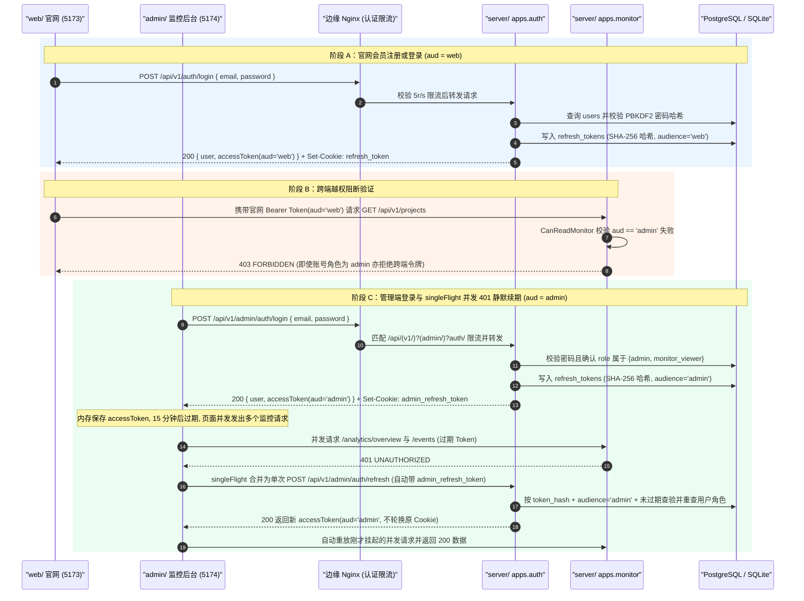
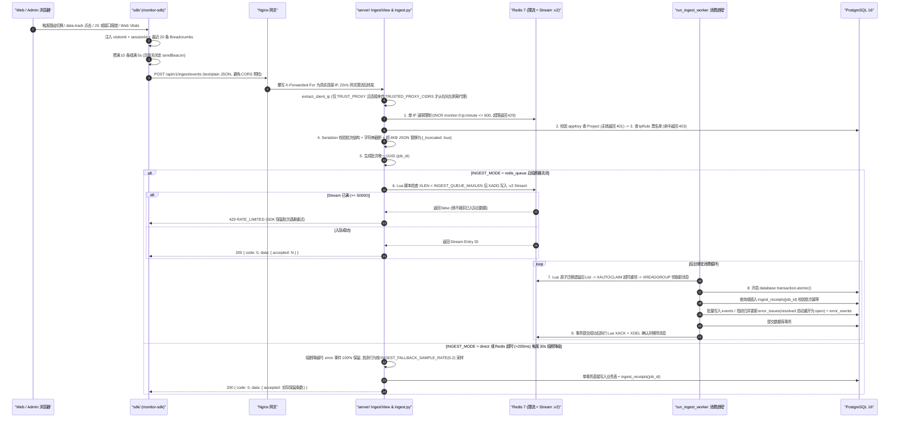
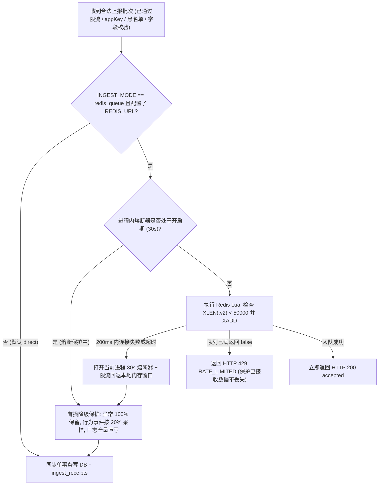
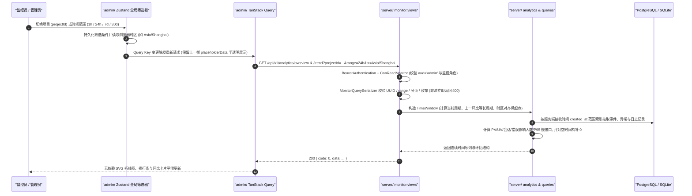
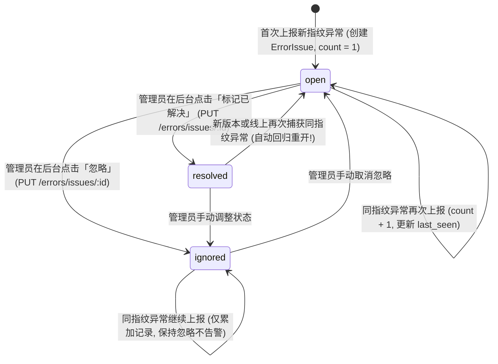
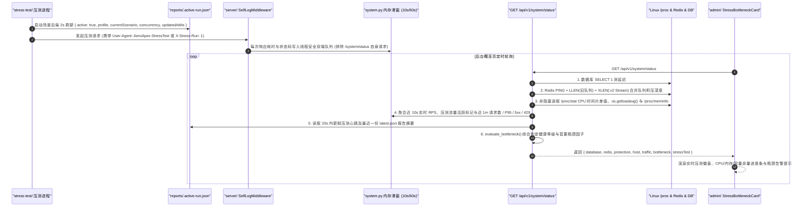
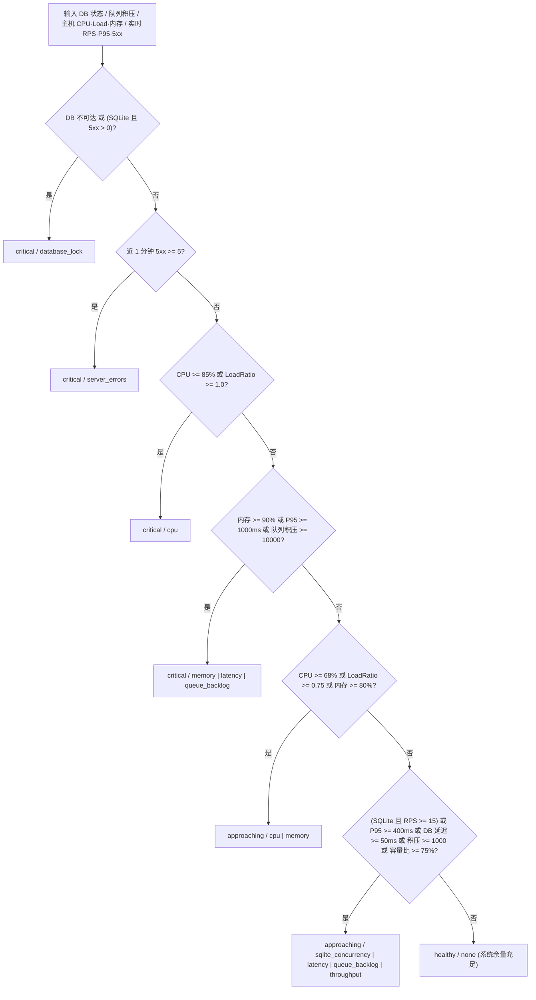
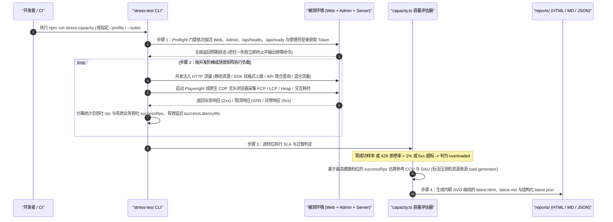

# 数据流向步骤图与分步解析

本文档按业务运行时的真实调用顺序，使用 Mermaid 时序图（`sequenceDiagram`）、状态图（`stateDiagram-v2`）与判定流程图（`flowchart`）拆解系统中的 **5 条核心数据流**，并对每一步的数据形态、校验规则与异常兜底做详细说明。

---

## 1. 前后台双端鉴权、Audience 隔离与静默刷新流

官网（`web/`）与管理后台（`admin/`）共用后端 `users` 表，但通过 **JWT `aud` 声明 + 独立路由前缀 + 独立 HttpOnly Cookie** 实现会话物理隔离，防止官网会话越权调用监控端，也避免一端退出导致另一端掉线。

### 分步说明
1. **网关入口防爆破**：官网 `/api/v1/auth/*` 与后台 `/api/v1/admin/auth/*`（含省略 `/v1` 的同源代理路径）均命中 Nginx `5r/s + burst 10` 速率限制，超限直接返回 `429`。
2. **双 Cookie 独立生命周期**：数据库 `refresh_tokens` 表仅保存随机串的 SHA-256 摘要及 `audience`（`web` 或 `admin`）；官网登出只删除 `refresh_token` 及其 `web` 记录，后台会话保持在线。
3. **管理端准入门槛**：普通官网会员（`role=user`）尝试调用 `/api/v1/admin/auth/login` 时，后端在签发 Cookie 前直接返回 `403 ADMIN_ACCESS_REQUIRED`。
4. **内存令牌与并发刷新合并**：两端前端均将 `accessToken` 仅保存在 JS 内存中（防 XSS 持久化窃取）；刷新页面或遇到并发 `401` 时，经 `singleFlight` 锁确保同一时刻只发出一笔 `/refresh` 请求。

---

## 2. 遥测上报、Redis Streams 削峰与 Worker 幂等落库流

这是监控系统的核心写入链路，支持 `direct`（同步直写）与 `redis_queue`（Redis 7 Streams 消费组异步缓冲 + 故障自动熔断降级）两种运行模式。

### 队列状态与故障降级决策图

### 关键步骤解析
- **严格校验顺序（省资源优先）**：先做内存/Redis 级 IP 限流（429）→ 再查 `appKey`（401）→ 再查 IP 黑名单（403）→ 最后做重度 JSON 字段序列化校验（400）。
- **异常指纹归并逻辑**：对 `type=error` 事件，后端提取「错误子类型 + 剔除数字/UUID/引号/URL 后的归一化消息 + 剔除行列号的堆栈首帧」计算哈希指纹；同一项目下相同指纹合并计数，若原状态为 `resolved` 则自动重新激活为 `open`（`ignored` 保持静默）。
- **至少一次投递 + 批次幂等**：Worker 崩溃或 ACK 网络丢失时，消息保留在 Stream PEL 中，超过 `INGEST_VISIBILITY_TIMEOUT_MS`（默认 60s）后被 `XAUTOCLAIM` 重新领取；重放时因 `ingest_receipts` 主键已存在而安全跳过，不会重复插入明细行。

---

## 3. 监控后台全局筛选、时区对齐聚合查询与异常处置流

### 前端异常问题（Issue）生命周期状态图

---

## 4. 实时流量滑窗、压测心跳感知与系统瓶颈评估流

为了让管理员在跑压测或遭遇流量洪峰时无需登录宿主机即可直观看到水位，系统构建了一条轻量级的内存态实时观测链路：

### 瓶颈等级（`evaluate_bottleneck`）判定优先级流程

---

## 5. 全栈压力测试执行与容量阶梯探顶数据流

### 容量数据流关键口径约束
1. **拒绝率隔离**：`429 RATE_LIMITED` 属于网关或应用的预期限流保护，不混入服务端崩溃错误率，但默认限流拒绝率超过 `1%` 或成功样本数为 `0` 时，该档位直接判定为 `overloaded`（不通过 SLA），杜绝“靠高速返回 429 刷出虚假高 QPS”。
2. **有效吞吐换算**：所有容量拐点 P95 与参考在线人数（CCU / DAU）一律仅由未限流的成功业务响应速率 `successRps` 计算得出。
