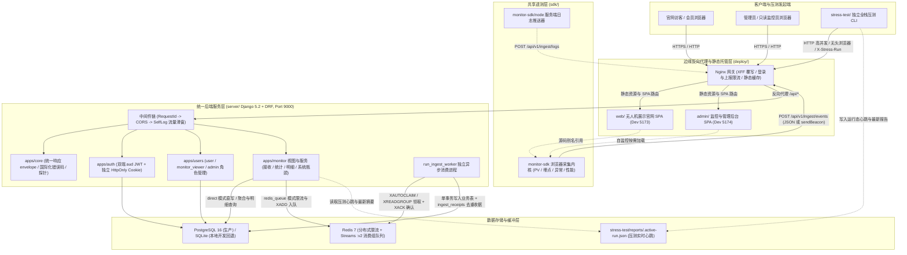
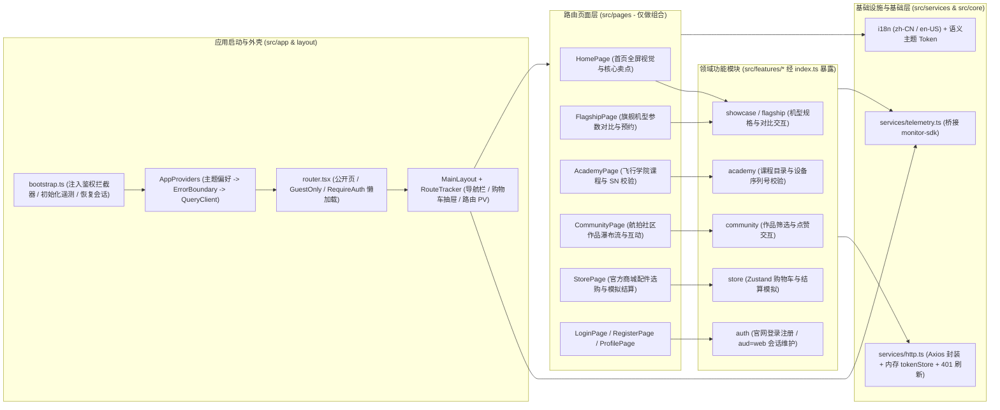
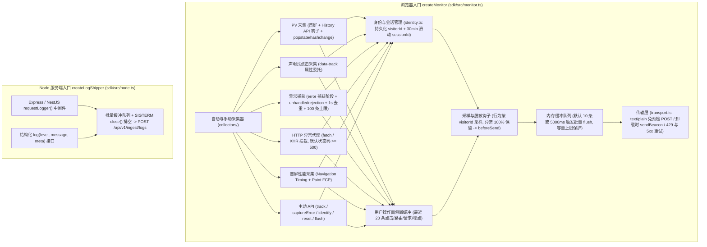
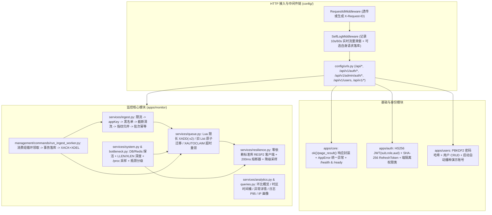
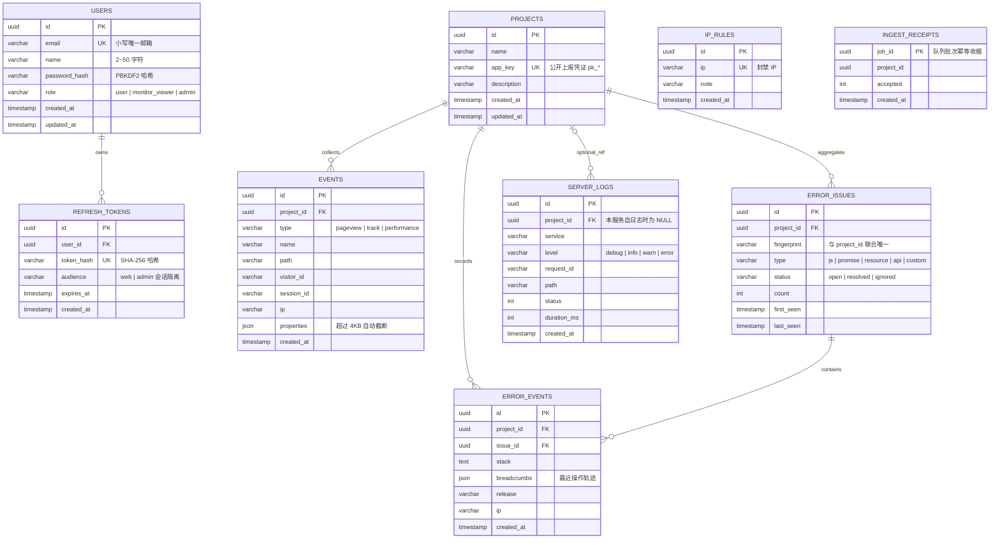
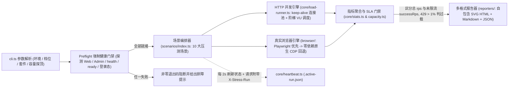
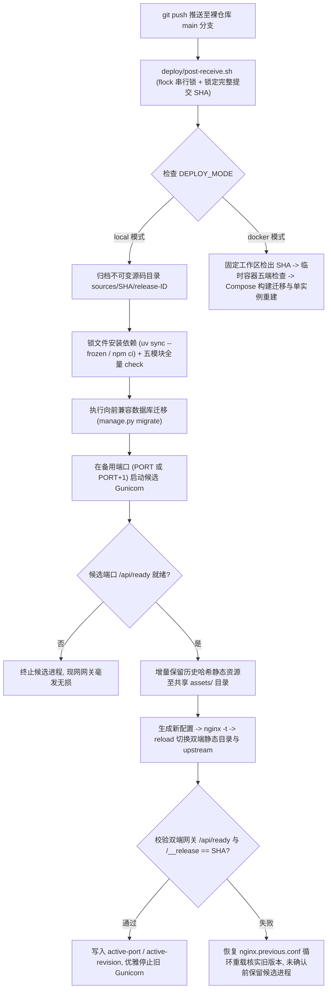

# 项目架构流程图与各子项目详解

本文档通过 Mermaid 架构流程图详细拆解 `drone-website` 的全栈拓扑结构，并逐一说明 `web/`、`admin/`、`sdk/`、`server/`、`stress-test/` 与 `deploy/` 六个组成部分的内部模块划分、关键实现入口及技术边界。

---

## 1. 全栈总体架构拓扑图

项目采用 **两个独立 React SPA + 一个共享零依赖 SDK + 一个 Django 模块化单体 + 一个独立全链路压测引擎** 的单体仓库（Monorepo 风格目录）结构，前后端与异步消费进程职责清晰，暂不拆分微服务。

---

## 2. 各子项目内部架构与职责详解

### 2.1 `web/` —— AeroApex 无人机展示官网（端口 `5173`）

`web/` 是面向终端访客与注册会员的品牌展示和体验前端，基于 React 19、Vite 8、Tailwind CSS v4、TanStack Query 5 与 Zustand 5 构建。

**关键设计说明：**
- **严格分层边界**：页面组件位于 `web/src/pages/`，只负责组装 `web/src/features/<模块>/index.ts` 导出的组件与 Hook；跨模块不穿透内部私有文件。
- **状态职责划分**：服务端会话数据归 TanStack Query 管理；跨页面客户端状态（购物车、语言、深浅色主题）归 Zustand 管理；临时弹窗与表单输入归组件内 `useState`。
- **遥测无缝接入**：`web/src/services/telemetry.ts` 动态加载 `../sdk`，关闭 SDK 自动 PV 与原生 fetch 劫持，改由 `RouteTracker` 上报路由切换、由 `http.ts` 的 `errorReporter` 统一上报接口异常、由 `ErrorBoundary` 捕获渲染崩溃。
- **真实业务边界**：登录、注册、会话刷新、个人资料（`/profile`）及遥测上报均对接真实 Django 后端；但**机型预约、SN 码校验、购物车结算、学院课程与社区帖子目前基于前端本地状态与静态数据模拟**，不包含真实支付或 CMS 后端。

---

### 2.2 `admin/` —— 监控与系统管理后台（端口 `5174`）

`admin/` 是面向运维与研发团队的可观测性控制台与用户管理端，技术底座与 `web/` 同源，但使用独立的管理端鉴权通道（`/api/v1/admin/auth/*`）与自研零依赖 SVG 图表组件库。

```mermaid
flowchart LR
    subgraph GuardShell["守卫与全局外壳"]
        Guard["RouteGuards (校验登录态 + admin 或 monitor_viewer 角色)"]
        Shell["AdminLayout (侧边导航 + 全局项目/时间窗筛选器 + JwtSessionDialog)"]
        Filters["features/filters (Zustand 持久化 projectId / range / 浏览器 tz)"]
    end

    subgraph AdminPages["核心业务视图 (src/pages -> src/features)"]
        Dash["DashboardPage (概览大盘: 瓶颈雷达 + 容灾状态 + 8 项环比 + 趋势)"]
        Traffic["TrafficPage (访问分析: PV/UV/会话/加载耗时 + 页面/来源/终端排行)"]
        Events["EventsPage (用户埋点: 事件汇总排行 + 多条件行为明细检索)"]
        Errors["ErrorsPage / ErrorDetailPage (异常聚合指纹 + 堆栈 + Breadcrumbs + 状态流转)"]
        Logs["LogsPage (后端日志: 吞吐/5xx 趋势 + 慢接口 P95 + requestId 串联)"]
        Ips["IpsPage / IpDetailPage (IP 综合画像 + 黑名单封禁规则)"]
        Projects["ProjectsPage (项目 CRUD + appKey 轮换 + SDK 接入代码生成)"]
        Users["UsersPage (全平台账号列表 + 角色分配 admin/monitor_viewer/user)"]
    end

    subgraph ChartsInfra["可视化与通信底座"]
        SVGCharts["components/charts (单 Y 轴 SVG 折线 / 排行条 / 键盘十字准线 / 表格切换)"]
        QueryLayer["TanStack Query (60s 自动轮询 + placeholderData 保帧防闪烁)"]
        AdminHttp["services/http.ts (Bearer aud=admin + admin_refresh_token 静默续期)"]
        SelfMon["services/telemetry.ts (可选自监控: 用自身 SDK 监控后台)"]
    end

    Guard --> Shell
    Filters --> AdminPages
    Shell --> AdminPages
    AdminPages --> SVGCharts
    AdminPages --> QueryLayer --> AdminHttp
    Shell --> SelfMon
```

**关键设计说明：**
- **双级权限控制**：`RouteGuards` 在前端阻断 `role=user` 的普通会员并展示无权限提示，`/register` 强制重定向至 `/login`；所有写按钮（新建/删除项目、轮换 `appKey`、修改异常状态、增删 IP 黑名单、管理用户）通过 `useIsAdmin()` 按角色控制显隐，且后端接口独立强制校验。
- **全局筛选联动**：顶栏切换项目或时间范围（`1h` / `24h` / `7d` / `30d`）后，自动携带浏览器 IANA 时区（如 `Asia/Shanghai`）触发当前活动页面的 Query Key 重新拉取，并使用 `keepPreviousData` 策略保持旧帧半透明过渡，避免页面抖动。
- **无障碍图表体验**：`admin/src/components/charts/` 不引入重型图表库，支持键盘左右方向键移动十字准线、色盲友好配色及一键切换为结构化数据表格。

---

### 2.3 `sdk/` —— 零依赖浏览器遥测与 Node 日志 SDK（`monitor-sdk`）

`sdk/` 提供纯 TypeScript 编写的轻量级采集器（浏览器端压缩后约 10 KB），同时供 `web/`、`admin/` 通过源码别名直接引用，也可独立打包为 ESM / CJS / IIFE 发布。

**关键设计说明：**
- **防自激死锁**：SDK 内部发往上报 `endpoint` 的请求带有内部标记，不会被自身的 `fetch/XHR` 代理或异常监听器二次捕获，彻底杜绝无限递归风暴。
- **跨域零预检与卸载可靠投递**：浏览器平时以 `Content-Type: text/plain` 发送 JSON 体（配合请求体 `appKey`），绕开浏览器 CORS `OPTIONS` 预检开销；页面隐藏（`visibilitychange`）或关闭（`pagehide`）时自动切换 `navigator.sendBeacon` 投递剩余批次。

---

### 2.4 `server/` —— Django 5.2 模块化单体后端（端口 `9000`）

`server/` 是整个系统的认证中心、监控接收网关、流式队列消费者与分析查询引擎，遵循 `apps/<模块>` 垂直分层（薄视图 `views` → 序列化校验 `serializers` → 业务逻辑 `services` → 模型 `models`）。

#### 核心数据库表结构与关联（ER 图）

---

### 2.5 `stress-test/` —— 独立全栈压力测试引擎

`stress-test/` 是与业务进程完全隔离的 Node.js + TypeScript 压测工具，用于验证静态资源、真实浏览器渲染、SDK 洪峰上报与后端聚合查询的承载表现。

---

### 2.6 `deploy/` 与 CI/CD —— 双模式发布与容灾编排

仓库在 `deploy/`、`docker-compose.prod.yml` 与 `.github/workflows/ci-cd.yml` 中提供了完整的检查与部署链路，其中 `DEPLOY_MODE=local` 具备单机双端口无损切换与自动回滚验证能力：

